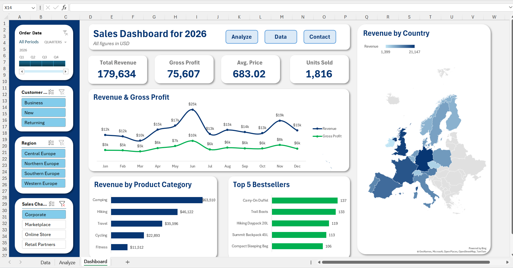

# Sales Dashboard 2026

## Project Overview

This project is an interactive sales dashboard built in Microsoft Excel
to monitor sales performance across products, customers, sales channels,
regions, and countries during 2026.

The dashboard brings key business metrics and visual summaries together
in one view to support sales monitoring and exploratory analysis.

## Dashboard Preview

## Key Performance Indicators

The dashboard highlights four headline metrics:

  KPI                   Value
  --------------- -----------
  Total Revenue     \$179,634
  Gross Profit       \$75,607
  Average Price      \$683.02
  Units Sold            1,816

## Dashboard Components

### 1. Interactive Filters

Users can filter the dashboard by:

-   **Order Date:** Select a period or quarter.
-   **Customer Type:** Business, New, or Returning.
-   **Region:** Central Europe, Northern Europe, Southern Europe, or
    Western Europe.
-   **Sales Channel:** Corporate, Marketplace, Online Store, or Retail
    Partners.

### 2. Revenue and Gross Profit Trend

A monthly line chart compares revenue and gross profit from January to
December 2026, making it easier to review changes in performance over
the year.

### 3. Revenue by Country

A geographic map visualizes revenue distribution across countries and
helps identify differences between markets.

### 4. Revenue by Product Category

A bar chart compares revenue across five product categories:

  Product Category      Revenue
  ------------------ ----------
  Camping              \$63,510
  Hiking               \$46,122
  Travel               \$35,596
  Cycling              \$22,893
  Fitness              \$11,512

### 5. Top 5 Bestsellers

The dashboard displays the five best-selling products by units sold:

  Product                  Units Sold
  ---------------------- ------------
  Carry-On Duffel                 137
  Trail Boots                     133
  Hiking Daypack 20L              119
  Summit Backpack 45L             113
  Compact Sleeping Bag            106

## Tools and Skills

-   Microsoft Excel
-   Interactive dashboard design
-   Data visualization
-   KPI reporting
-   Sales performance analysis
-   PivotTables, charts, and slicers *(include these only if they were
    used in the workbook)*

## How to Use

1.  Download or open the Excel workbook included in this repository.
2.  Open the **Dashboard** worksheet.
3.  Use the available filters to explore the data by date, customer
    type, region, and sales channel.

## Project Files

-   `Sales-Dashboard.xlsx` --- Excel workbook containing the dashboard
    and supporting worksheets.
-   `Dashboard-Preview.png` --- Preview image of the dashboard.

## Notes

This is a portfolio project for demonstrating Excel-based sales
reporting and dashboard design. The figures shown above are the values
displayed in the dashboard; they should not be interpreted as verified
results from a real company unless the underlying dataset is confirmed
to be real.
